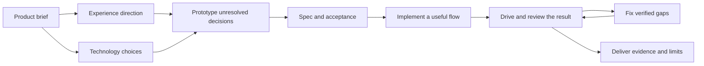

# MyNewAgent

Project-local instructions for choosing suitable technology, developing an interface's identity, and verifying the finished work. Install the package once, then describe the product you want to build.

A quiet scheduling tool and an immersive launch site need different design decisions. MyNewAgent supports both, with a shared requirement for usable behavior, appropriate technology, and evidence of what actually works.

[Install and update](SETUP.md) | [Agent hooks](HOOKS.md) | [Prompt and usage review](USAGE.md) | [Optional Jev routing](JEV.md) | [Harness support](HARNESS.md) | [Sessions and budget](SESSIONS.md) | [Rules](RULES-INDEX.md) | [Workflow checks](WORKFLOW-CHECKS.md)

<!-- reference-contents:start -->
## Contents

- [Start with the product](#start-with-the-product)
- [Two decisions, made separately](#two-decisions-made-separately)
- [Keep the idea through implementation](#keep-the-idea-through-implementation)
- [Install into an existing project](#install-into-an-existing-project)
- [Give the workflow automatic checks](#give-the-workflow-automatic-checks)
- [Use Jev skill suggestions](#use-jev-skill-suggestions)
- [Understand the evidence](#understand-the-evidence)
- [Maintain the package](#maintain-the-package)
<!-- reference-contents:end -->

## Start with the product

Give the agent the audience, main task, constraints, and any decisions you have already made. These are complete starting prompts you can adapt:

> Build a restrained scheduling application for receptionists. Prioritize finding and changing appointments with the keyboard. Keep the existing Vue frontend and Python API. Preserve our typography and use minimal motion.

> Plan an immersive launch site for our bicycle workshop. Visitors should explore frame details and book a fitting. We have original photographs and no 3D assets. Compare suitable technology choices before scaffolding, then prototype the most uncertain interaction.

> Compare technology options for an offline command-line tool that processes our CSV exports. The maintainers know Python. Explain the meaningful tradeoffs in chat without installing anything.

The agent should inspect existing work, resolve consequential gaps, and proceed with ordinary choices within the task. A small fix keeps its small scope. You can request a checkpoint when you want to review a direction before implementation.

## Two decisions, made separately

| Decision | What informs it | Where it lives |
|---|---|---|
| Visual expression | Audience, core task, content, brand, repeated use, and your preference for restrained, expressive, or immersive work | [Creative direction](skills/creative-direction/SKILL.md) |
| Technology | Existing code, team knowledge, rendering needs, data, integrations, deployment, cost, and maintenance | [Choose a stack](skills/choose-stack/SKILL.md) |

Professional quality applies to every expression level. An existing or chosen stack stays in place unless the requested work establishes a reason to reconsider it. Framework-specific skills guide implementation after selection.

The technology workflow compares the layers that need a decision. It can recommend a frontend and backend from different ecosystems, or omit a framework, database, or server that the product does not need. It asks for current primary-source evidence when support, compatibility, licensing, or cost could decide the outcome.

## Keep the idea through implementation

For substantial UI work, the workflow connects the brief, reference observations, asset plan, prototypes, and rendered review. Reuse approved decisions rather than restarting design at every stage.



The prototype can compare layouts, exercise logic, or test one interaction with representative timing and inputs. Use the existing app when its surrounding context matters, and a separate experiment when it does not. A motion study includes interruption, reset, keyboard/touch behavior, and reduced-motion fallback where relevant.

| Project record | Purpose |
|---|---|
| `CONTEXT.md`, or the existing equivalent | Product purpose, stack, domain terms, experience reference, and durable decisions. Glossary updates preserve the other sections. |
| `DESIGN.md`, or the existing equivalent | A substantial interface's direction, content/assets, key interactions, and observable acceptance. Use the [brief outline](skills/creative-direction/BRIEF.md) selectively. |
| Existing specs and tickets | Implementation scope, split into phases that each end at an observable exit, with links to the selected design, technology rationale, and relevant prototype evidence. |
| `PROGRESS.md`, generated | Current phase, tickets in progress and by whom, next, blocked, and how to resume, derived from the spec and ticket files. Edit the tickets, not this file. |
| Verification evidence | Actual outputs, screenshots, interaction observations, and measurements, with the environment and limits recorded. |

These are conventions for useful records, not files to generate for every task. Advice-only requests can stay in chat.

## Install into an existing project

Keep this source folder outside the target project. Bash and Python 3.9 or newer are required; the installer and package validator use the Python standard library.

```bash
bash "/path/to/MyNewAgent/validate.sh"
bash "/path/to/MyNewAgent/setup.sh" --harness all "/path/to/your-project"
bash "/path/to/your-project/.agents/validate.sh"
```

Supported installer targets are `all`, `portable`, `codex`, `claude`, `gemini`, `cursor`, `copilot`, and `antigravity`. The installed instructions live in `.agents/`; generated entry points tell the selected harness how to load them. When native skill discovery is unavailable, the agent can read a relevant `SKILL.md` directly.

Add `--with-jev` to include the optional Jev router; later updates keep that choice. A first install refuses to replace files already in `.agents/` unless you pass `--adopt`, which backs them up first. `--uninstall` removes the hook registrations and the managed blocks in entry points, then moves `.agents/` into a backup.

Version 1.7.0 removes seven old skill names that 1.6.0 kept as redirects. Use `grilling` for `grill-me` and `grill-with-docs`, `wait-what` for `bro`, `implement` for `implement-spec`, `tdd` for `tdd-bugfix`, `teach` for `teach-explain`, and `claude-model-migration` for `claude-opus-4-5-migration`. Updating a project removes the old names and keeps a copy of each in the backup.

Start a new session in the target project and verify which instructions were loaded. See [SETUP.md](SETUP.md) for preservation, backups, update behavior, and installation verification. Updating this source folder does not update projects that already have an installed copy.

## Give the workflow automatic checks

Optional hooks connect the package's verification commands to agent lifecycle events. They check changed package files, reuse passing results only while the relevant contents match, and allow one focused completion follow-up. Startup notes and local checkpoints help agents resume work; structured handoffs keep delegated results reviewable. When a project has local tickets, the session start note names the phase and the claimed or next ticket, and the hooks regenerate `PROGRESS.md`.

After installing into a project, register hooks for the tool you use:

```bash
cd /path/to/your-project
python3 -B .agents/scripts/setup_hooks.py --harness codex .
```

Choose `codex`, `claude`, `cursor`, or `all`. Registration preserves unrelated hooks and settings. It does not change global configuration or approve native trust prompts. Package installation alone leaves hook registration unchanged.

The same command works in this source folder with `scripts/setup_hooks.py`. See [the hook guide](HOOKS.md) for activation, removal, verification coverage, and limitations. Lifecycle hooks use Python's standard library and make no network requests. Other command-capable runners can call the shared runtime with `--harness portable` and map their own events.

Jev skill suggestions are optional and off by default; [the next section](#use-jev-skill-suggestions) explains how to turn them on.

Project installation initializes `prompt-log.md`, preserving existing history and ignoring local logs in Git. Hooks capture each new request and the agent's reply to it, with best-effort redaction. The [budget-review skill](skills/budget-review/SKILL.md) combines measured model usage with relevant log entries to suggest concrete prompting improvements. It reports missing token or price data as unknown. See [USAGE.md](USAGE.md) for portable recording commands and coverage limits.

## Use Jev skill suggestions

Jev is a fast, low-cost choice model from [TypeSafe](https://docs.typesafe.ai/models). With this package, it reads each new request and suggests which skill fits, or `none`. It is off until you install it, register its hook, and enable it in `.env`. It never blocks a prompt. If Jev is slow, down, or out of allowance, the agent carries on without a suggestion.

It has two modes. In `shadow`, the default, Jev records what it would suggest but tells the agent nothing. Use it to measure Jev against the skills the agent picks on its own. In `advisory`, a confident suggestion for a new task reaches the agent as an optional hint. The agent still decides whether the skill fits.

1. Install the component into your project. Pass the same `--harness` you installed with, because the installer defaults to every harness. Later updates keep Jev without the flag.

   ```bash
   bash /path/to/MyNewAgent/setup.sh --harness claude --with-jev /path/to/your-project
   ```

2. Set these values in the project's `.env`, beside `.agents/`. If the project has no `.env`, copy `.agents/.env.example` to `.env` and change the values in it. In an existing `.env`, add only the keys it lacks. Each key may appear only once. The router rejects a `.env` with a duplicate key, and Jev then stays silent. Keep `.env` out of Git. A call needs all three of `JEV_ENABLED=true`, a key, and a session allowance above zero.

   ```dotenv
   TYPESAFE_API_KEY=your-key
   JEV_ENABLED=true
   JEV_MODE=shadow
   JEV_MAX_REQUESTS_PER_SESSION=50
   JEV_MAX_REQUESTS_PER_DAY=500
   ```

3. Register the prompt hook, then start a new agent session. `--local` writes your own `.claude/settings.local.json`, so collaborators are not opted in. It also moves the package's other hooks out of the shared `.claude/settings.json` into that file, so none run twice. If the shared file is committed and should keep those hooks, use `--jev-local` instead of `--jev --local`: it adds only the Jev hook to your local file and leaves the shared file alone. For Codex, use `--harness codex --jev` instead. Codex has no local settings file, so that registration applies to everyone who uses the project.

   ```bash
   cd /path/to/your-project
   python3 -B .agents/scripts/setup_hooks.py --harness claude --jev --local .
   ```

4. Work as usual for a while in shadow mode, then compare Jev's suggestions with the skills the agent actually loaded. Shadow calls still use API credits.

   ```bash
   python3 -B .agents/scripts/evidence.py report --format markdown
   ```

5. To switch to advisory mode, set `JEV_MODE=advisory` in `.env`. The hook reads `.env` on every prompt, so the change applies from your next prompt. To go back, set `JEV_MODE=shadow`. A suggestion reaches the agent only when Jev's top choice reaches `JEV_MIN_TOP_PROBABILITY`, leads the runner-up by `JEV_MIN_MARGIN`, and passes `JEV_MIN_GATE`. The defaults are 0.85, 0.20, and 0.30; change them in `.env` to make advice more or less frequent.

6. To stop calls, set `JEV_ENABLED=false`. To remove the hook as well, run `python3 -B .agents/scripts/setup_hooks.py --harness claude --remove .`, naming the host you registered in step 3, then rerun the step 3 command without `--jev`. For a hook added with `--jev-local`, run `setup_hooks.py --harness claude --jev-local --remove .`, which removes only that hook.

Each session may make `JEV_MAX_REQUESTS_PER_SESSION` calls, and the whole project `JEV_MAX_REQUESTS_PER_DAY`. Before sending a prompt, the router runs the prompt logger's best-effort redactor over the part it would send, plus a 64 KiB margin, and sends nothing if it finds a secret there. It cannot recognize every secret, so keep secrets out of prompts. A prompt that names a skill with `$skill-name` or `/skill-name` skips Jev. To see recent decisions, including failures and their reasons, pipe `{"session_id":"..."}` with your session's ID into `python3 -B .agents/scripts/jev_router.py history`. In this source folder, run the same scripts from `scripts/`, and register Jev with `python3 -B scripts/setup_hooks.py --harness claude --jev-local .` so the tracked `.claude/settings.json` keeps its hooks. [JEV.md](JEV.md) covers every setting, the offline request preview, privacy, pricing, and the benchmark to rerun when Jev or the skill catalog changes.

## Understand the evidence

Run the package checks from this source folder:

```bash
bash validate.sh
python3 -B -m unittest discover -s tests -v
```

| Check | What it establishes |
|---|---|
| Package validation | Required entry points, skill provenance and lifecycle metadata, current third-party notices, invocation settings that agree across hosts, rule routing, declared resources, relative links, profile syntax, and script syntax. |
| Regression tests | Installer preservation and rollback, ownership tracking, validation failures, hook registration and lifecycle behavior, each host's documented hook payloads, the git guard, benchmark statistics, and worktree audit behavior in temporary fixtures. |
| [Workflow scenarios](WORKFLOW-CHECKS.md) | Whether an agent applies the decision process to realistic requests. Planning responses are evaluated separately from executed builds. |
| Application verification | Whether the built product works under the actual inputs, devices, and conditions exercised. |

An experience review reports verified behavior and measurements, design judgments, and unverified items separately. A successful build does not establish a good interaction. A favorable planning exercise does not establish real audience recall. The package cannot guarantee awards or popularity.

## Maintain the package

[AGENTS.md](AGENTS.md) is the shared entry point. [RULES-INDEX.md](RULES-INDEX.md) routes the rules, and [resources.json](resources.json) declares required skill companions. The frontend rule points to canonical design guidance so revisions do not need to be copied into two rulebooks.

When changing workflows, update their callers and declared resources, run the relevant checks, and install into a disposable project before updating a working project. Keep the [setup guide's maintenance process](SETUP.md#version-and-maintenance) and version current.

Each skill's frontmatter records its source (with a top-level license for imported skills), status, and last review date. `bash validate.sh` lists skills not reviewed in 180 days. After importing or changing a skill, `python3 -B scripts/third_party_notices.py --write` regenerates [THIRD_PARTY_NOTICES.md](THIRD_PARTY_NOTICES.md). Most skills come from the projects credited there, under the MIT or Apache-2.0 license, and the license texts are in `licenses/`.

When a host changes its hook payloads, update its fixture in `tests/fixtures/hosts/` first and let the failing tests show what to change. When TypeSafe releases a new Jev model, rerun the benchmark and compare it with the last run before switching ([JEV.md](JEV.md#re-run-the-benchmark-when-jev-or-the-catalog-changes)). The [retro skill](skills/retro/SKILL.md) reads the local usage evidence and proposes catalog changes for you to approve.

Run `python3 -B scripts/reference_contents.py --check` to check the Contents lists in reference documents over 100 lines. Use `--write` to refresh them after changing headings. The generator preserves the document body and ignores headings inside code examples.

The user's task governs scope within the host's system rules and enforced permissions. [Autonomy configuration](autonomy-config.md) and [safe research](rules/safe-research.md) define the shared boundaries. Markdown supplies guidance; the host's sandbox and permissions enforce access. The installer does not connect accounts, change global settings, or enable broad permissions.
